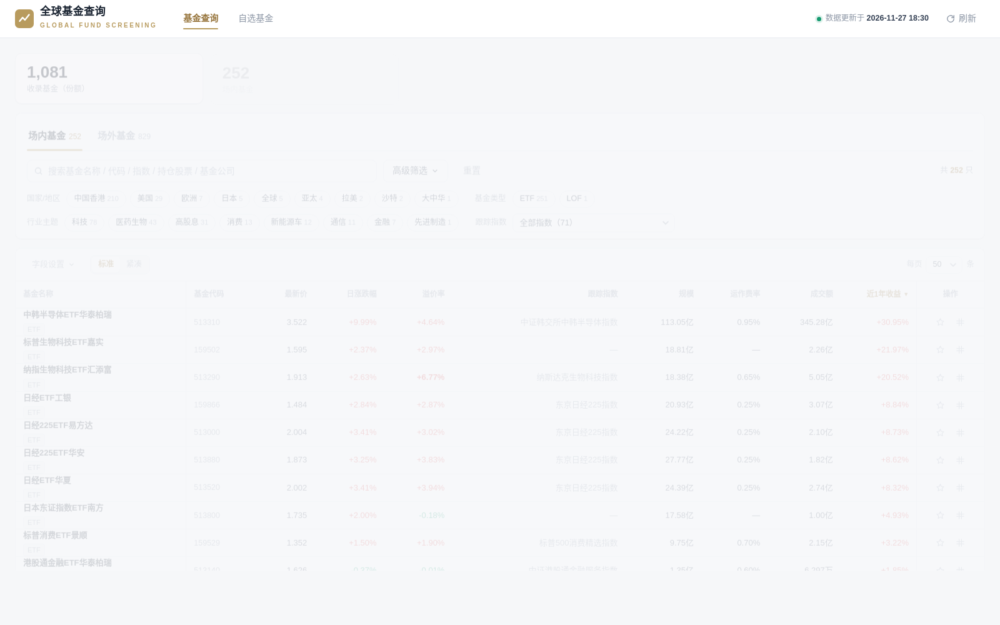
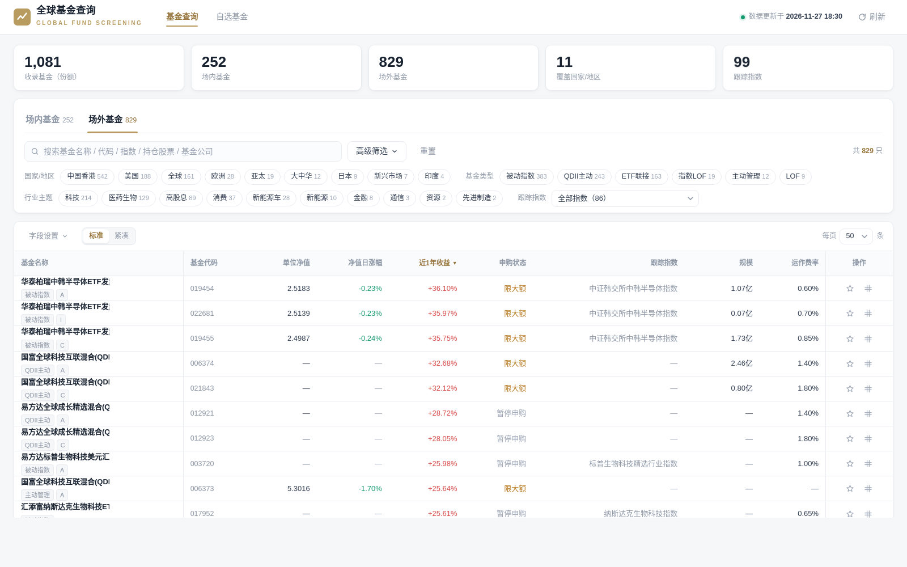
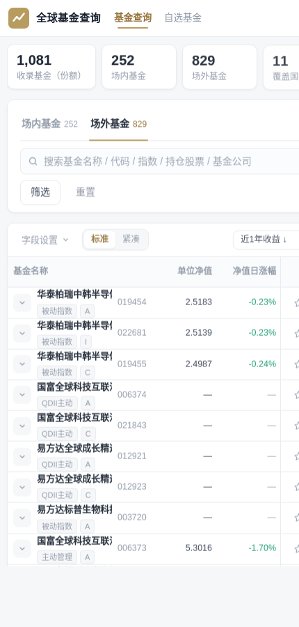

# 全球基金查询 · Global Fund Portal

非 A 股基金数据门户：面向境内投资者，提供**跨境 ETF/LOF、QDII、ETF 联接、境外指数基金、境外权益主动基金**的查询、筛选、排序与对比，帮助解决三个问题：

- **买什么** —— 按国家/地区、跟踪指数、行业主题、持仓股票筛选基金
- **买哪只** —— 按收益率、运作费率、规模、最大回撤、跟踪误差比较基金
- **现在买贵不贵** —— 按溢价率、流动性（成交额）、申购限额辅助交易决策

> 全站数据**每日自动**从东方财富·天天基金公开接口抓取，逐基金实时核对，不做任何人工虚构；每只基金均可一键回溯到天天基金档案页。

| 场内基金（PC） | 场外基金（PC） | 移动端 |
|---|---|---|
|  |  |  |

## ✨ 功能

- **场内 / 场外两个独立查询页**，同时支持两种交易方式的基金（如跨境 LOF）在两页分别展示对应数据
- 场外基金按份额（A/C/人民币/美元）独立展示，不混用数据
- 高信息密度数据表格：固定表头、固定左侧基金名称、固定右侧操作列、横向滚动、**列宽拖拽调整、自定义展示字段、全字段排序（缺失值沉底）、分页、紧凑/标准两种密度**
- 筛选：关键词搜索（名称/代码/指数/持仓股票/公司）、国家/地区、基金类型、行业主题、跟踪指数 + 高级筛选（规模区间、运作费率上限、溢价率区间、近1年收益下限、流动性、申购状态）
- **多基金对比**（最多 5 只）：基本信息 / 区间收益 / 风险 / 费用 / 交易信息分组对照
- **自选基金**：本地收藏，跨页签查看
- 基金详情：核心指标、近1年净值走势图、前十大持仓、天天基金档案直达
- PC 金融终端布局（1440/1920 优先，兼容 1024+），移动端专属响应式布局（底部筛选面板、展开式行、安全区适配）
- 科技白金视觉：香槟金品牌色 + 红涨绿跌 + 等宽数字

## 🗂️ 目录结构

```
├── index.html                  # 单页应用入口（无构建）
├── assets/
│   ├── css/style.css           # 科技白金设计系统
│   └── js/app.js               # 查询/筛选/排序/对比/自选/详情
├── data/
│   ├── meta.json               # 更新时间与统计（由采集脚本生成）
│   ├── etf.json                # 场内基金（跨境ETF/LOF 行情+基本面）
│   ├── otc.json                # 场外基金（QDII/联接/指数/主动）
│   └── trend/{code}.json       # 各基金近1年净值走势（详情页懒加载）
├── scripts/fetch_data.py       # 数据采集管道（唯一数据写入方）
└── .github/workflows/
    └── update-data.yml         # 每日定时更新数据并提交
```

## 📡 数据来源（全部公开接口）

| 数据 | 来源 |
|---|---|
| 基金名录与区间收益率 | 天天基金排行榜接口（ft=qdii / zs） |
| 场内行情、折溢价、IOPV、成交额 | 东方财富行情中心（push2delay） |
| 净值走势、规模变动、基金经理 | 天天基金 pingzhongdata |
| 基金类型、费率、跟踪标的、规模 | 天天基金 F10 基本概况 |
| 跟踪误差 | 天天基金 F10 特殊数据 |
| 前十大持仓 | 天天基金 F10 持仓接口 |
| 申购状态、申购限额 | 天天基金基金主页 |

收录范围：境内发行、主要投资于非 A 股市场的公募**权益类**基金；剔除黄金、原油、商品、债券、REITs、货币等非权益品种。

## 🚀 本地运行

```bash
# 1. 更新数据（Python 3.8+，仅依赖 requests）
pip install -r scripts/requirements.txt
python3 scripts/fetch_data.py

# 2. 起本地服务
python3 -m http.server 8000
# 浏览器打开 http://localhost:8000
```

调试模式：`LIMIT=20 python3 scripts/fetch_data.py` 只抓少量基金快速验证。

## 🔄 数据更新机制

仓库内置 GitHub Actions（`.github/workflows/update-data.yml`）：

- 每日北京时间 09:00 / 20:00 自动运行采集脚本
- 数据有变化时自动提交到 `main` 分支
- 若已开启 GitHub Pages，页面内容随之自动更新

## 📄 部署到 GitHub Pages

仓库 Settings → Pages → Source 选择 `main` 分支 `/ (root)` 即可。
站点为纯静态文件，任意静态托管（Vercel / Netlify / 对象存储）均可直接使用。

## ⚠️ 免责声明

本站为公开数据的信息汇总与筛选工具，不构成任何投资建议。数据可能存在延迟或误差，请以基金管理人官方披露为准。基金有风险，投资需谨慎。
